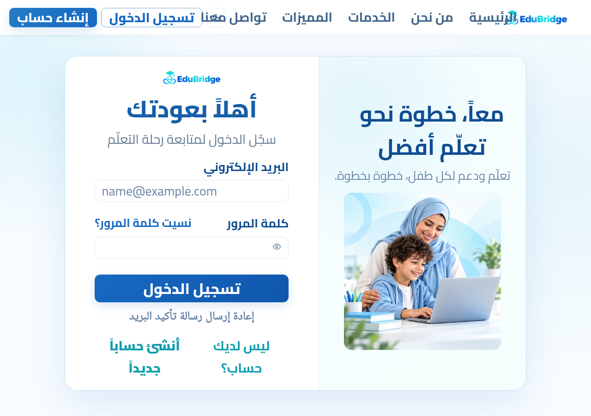
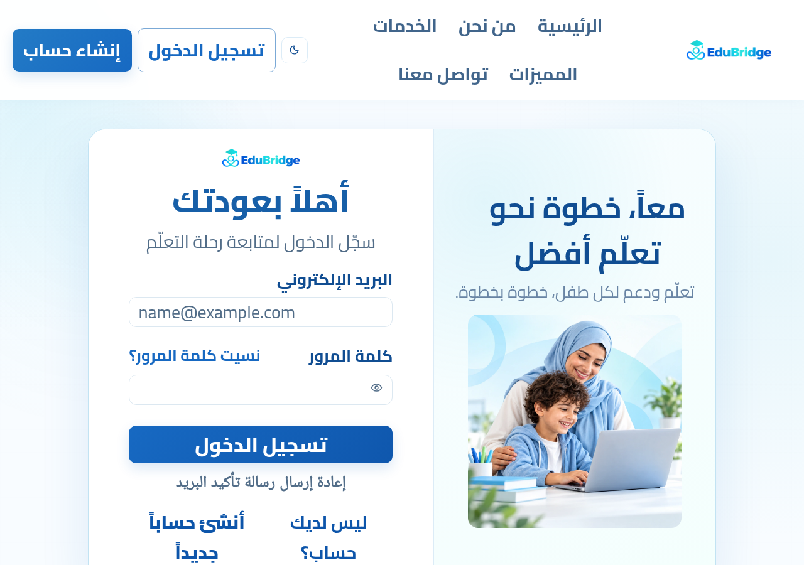
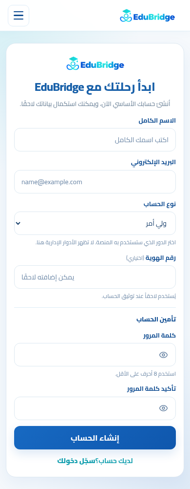
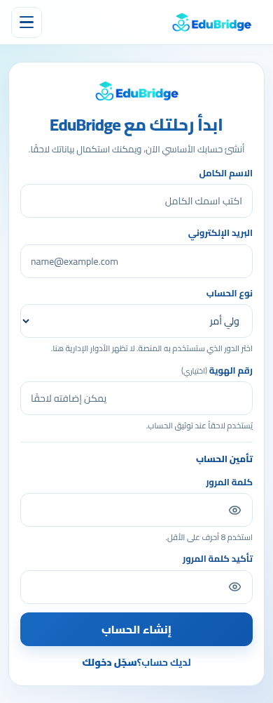
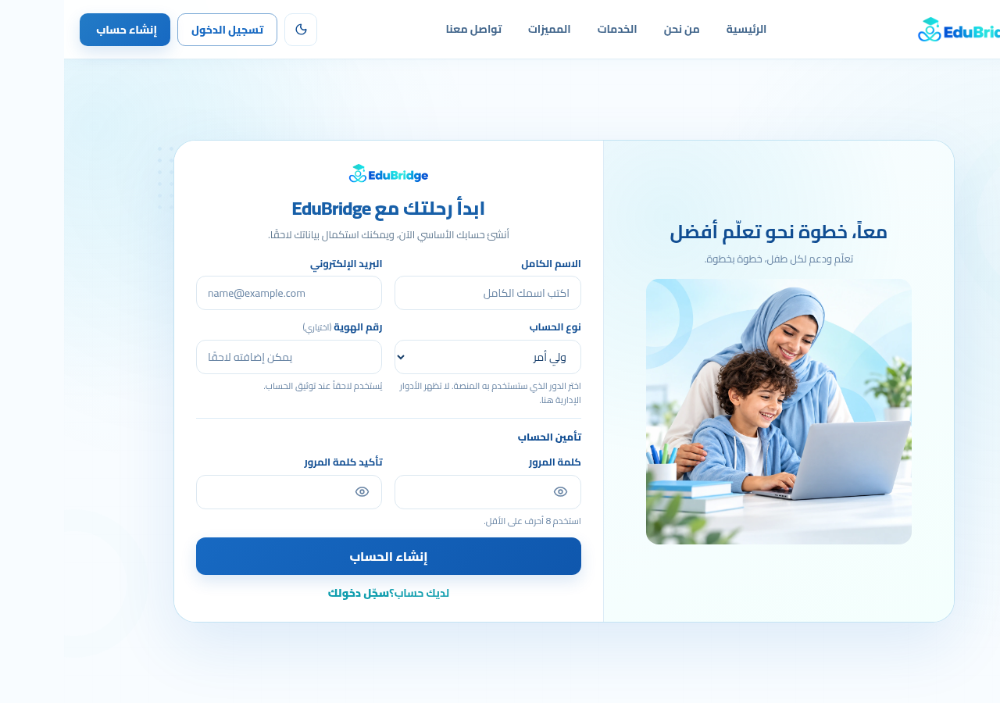
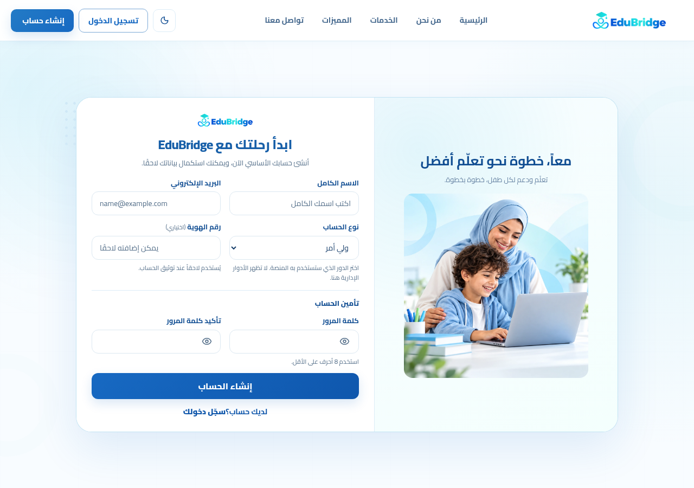
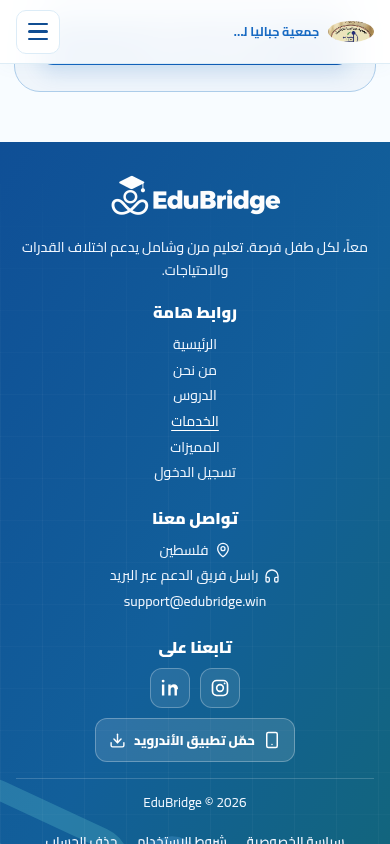
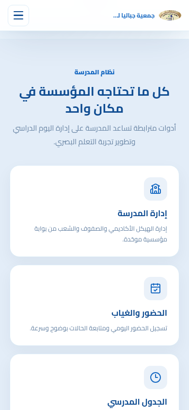

# EduBridge — تقرير QA وUI/UX والإصلاحات

التاريخ: **10 نوفمبر 2026، بتوقيت آسيا/غزة**. الفرع: `fix/qa-ui-ux-audit` → `main`.

النسخة المرجعية: `611202313c8f3190f0a899162fd4a4d0f831ffc2`، وهي أحدث `main` وقت بدء العمل وإعادة التحقق قبل التسليم. الحساب المتصل: `MohammedEmad333`.

## النتيجة وحدودها

نُفذت إصلاحات فعلية في React وCSS، مع ثمانية اختبارات انحدار في متصفح Chromium وربطها بفحص GitHub Actions الموجود. لا توجد تغييرات Laravel أو قاعدة بيانات أو خادم أو Cloudflare أو Docker، ولم يُدمج الفرع أو يُنشر. الموقعان المنشوران ما زالا يعرضان النسخة السابقة إلى أن تتم مراجعة التعديلات ونشرها بصورة منفصلة.

الواجهة المصححة **جاهزة للمراجعة** وفق الاختبارات أدناه، لكن الموقع **غير حاصل على قبول وظيفي شامل A01–A19**. لا توجد بيئة Staging مع حسابات اصطناعية متاحة في هذه الجلسة. لم تُرسل نماذج إنتاج، ولم تُنشأ سجلات أو تُستخدم بيانات طلاب حقيقية.

## الصفحات العامة التي فُحصت

فتح الموقع الرئيسي وجباليا في متصفح حقيقي، والتنقل في الرأس والتذييل والنماذج دون إرسالها. نُفذت مصفوفة Chromium قرائية من **110 زيارات: 11 صفحة × 5 مقاسات × موقعين**، على `https://edubridge.win` و`https://jabalia.edubridge.win`.

المقاسات: **320، 390، 720، 1280، 1920 بكسل**، بارتفاع 900 بكسل. كل هذه الزيارات أعادت HTTP 200 ولم تسجل استثناءات JavaScript غير معالجة أو ردود HTTP فاشلة للموارد المسموح بها. حُجبت موارد الجهات الخارجية في الجولة الآلية، لذلك لا تتضمن هذه النتيجة نجاح Google OAuth أو المواقع الخارجية. ظهر زر Google في الفحص اليدوي دون تسجيل دخول.

| المسار | ما تمت مراجعته | التغطية |
|---|---|---|
| `/` | الرئيسية | 5/5 على كل من الموقع الرئيسي وجباليا |
| `/about` | من نحن | 5/5 على كل من الموقع الرئيسي وجباليا |
| `/login` | تسجيل الدخول | 5/5 على كل من الموقع الرئيسي وجباليا |
| `/register` | إنشاء حساب | 5/5 على كل من الموقع الرئيسي وجباليا |
| `/forgot-password` | طلب استعادة كلمة المرور | 5/5 على كل من الموقع الرئيسي وجباليا |
| `/reset-password` | رابط استعادة ناقص، دون تعيين كلمة مرور | 5/5 على كل من الموقع الرئيسي وجباليا |
| `/school-account/setup` | حالة رابط إعداد مدرسة ناقص | 5/5 على كل من الموقع الرئيسي وجباليا |
| `/school/invitation` | حالة دعوة مدرسة ناقصة | 5/5 على كل من الموقع الرئيسي وجباليا |
| `/privacy.html` | سياسة الخصوصية | 5/5 على كل من الموقع الرئيسي وجباليا |
| `/terms.html` | شروط الاستخدام | 5/5 على كل من الموقع الرئيسي وجباليا |
| `/delete-account.html` | تعليمات حذف الحساب؛ قراءة فقط | 5/5 على كل من الموقع الرئيسي وجباليا |

المصدر القابل للمراجعة: [نتائج الإنتاج القرائية](qa-ui-ux-2026-11-10/live-audit.json). فُحصت أقسام الرئيسية: التعليم الدامج، الجمهور، الخدمات، المميزات، نور، خطوات البدء، المجتمع والتذييل. جُرّبت روابط الخدمات والمميزات بين الصفحات.

## صفحات الأدوار — اختبار محلي ببيانات وهمية

فُحصت **86 حالة عرض** على 320 و1280 بكسل، تمثل **42 مسارًا مختلفًا عبر تسعة أدوار**؛ مسار المدرسة تكرر لدوري المدرسة والمدير. استُخدمت ردود اصطناعية للقوائم الفارغة وبعض تفاصيل الطفل والمدرسة. لم تظهر استثناءات غير معالجة أو تمرير أفقي في هذه الحالات. هذه اختبارات تركيب وعرض وحالات أولية، ولا تثبت صحة كل عملية أو كل تبويب أو صلاحيات الخادم. الوحدات الداخلية والإجراءات التي تحتاج بيانات أو خادمًا حقيقيًا تظل ضمن قيود القبول أدناه.

| الدور | المسارات التي عُرضت محليًا |
|---|---|
| `parent` | `/parent`، `/children`، `/children/new`، `/children/9001`، `/children/9001/edit`، `/children/9001/lessons`، `/children/9001/progress`، `/children/9001/games`، `/lessons`، `/homeworks`، `/weekly-reports`، `/parent-lessons`، `/care-team`، `/learning-support`، `/consultations`، `/notifications`، `/conversations`، `/profile`، `/verify`، `/support` |
| `teacher` | `/teacher`، `/teacher/invitation`، `/lessons/new`، `/search`، `/case-discussions` |
| `specialist` | `/specialist`، `/specialist-workflow`، `/accessibility`، `/children/9001/accessibility` |
| `admin` | `/admin`، `/admin/verifications` |
| `ministry` | `/ministry` |
| `institution` | `/institution`، `/institution/schools`، `/institution/teachers`، `/institution/students`، `/institution/attendance`، `/institution/timetable`، `/institution/substitutions`، `/institution/reports` |
| `school` | `/school` |
| `school_director` | `/school` |
| `student` | `/student` |

الدليل: [سجل حالات العرض الاصطناعية](qa-ui-ux-2026-11-10/auth-audit.json). راجعت بنية المسارات وReact lazy loading، وسياسات التوثيق، وملفات الأدوار والصلاحيات، وعقود A01–A19، والاختبارات الموجودة. React 19 وVite؛ Laravel 13 مع PHP 8.4 حسب ملفات المشروع. إخفاء زر الواجهة لا يعد إثباتًا لحماية الخادم.

## المشاكل المؤكدة والإصلاحات

لم يُثبت خلل P0 في هذا النطاق؛ الفحص المحدود لا ينفي وجود أخطاء أمنية في الأجزاء المحجوبة.

| المعرف | الأولوية | المشكلة والسبب | الإصلاح المنفذ | الدليل |
|---|---|---|---|---|
| QA-01 | P1 | فتح قائمة الجوال ثم الانتقال لسطح المكتب يبقي `body overflow:hidden`؛ الحالة لا تتبع نقطة التحول | مكوّن مشترك يتابع نقطة التحول، يغلق القائمة ويعيد قيمة التمرير السابقة | اختبار انحدار القائمة: PASS؛ قبل الإصلاح بقي التمرير hidden |
| QA-02 | P2 | Escape لا يغلق القائمة، والتركيز يمكن أن يصل إلى عناصر قائمة الدور المخفية؛ الشعار عنصر div قابل للنقر فقط | Escape، دورة Tab وShift+Tab، إعادة التركيز، inert للقوائم المغلقة، aria-controls/expanded، تحويل الشعار إلى رابط ذي تركيز مرئي؛ إظهار فوري للقائمة وتعطيل حركتها عند تفضيل تقليل الحركة | اختبارات القائمة العامة وقائمة الدور والتنقل بالشعار: PASS |
| QA-03 | P2 | زخارف التسجيل المطلقة تخرج من الحاوية ذات overflow visible؛ العرض يصبح 1362 عند 1280، و2002 عند 1920 | طبقة قص للزخارف وحدها تحفظ تمرير النموذج وحدود التركيز | بعد الإصلاح 1280→1280 و1920→1920؛ المقاسات الخمسة PASS |
| QA-04 | P2 | نصوص التسجيل وروابط الاستعادة أقل من تباين AA: 3.87 و4.39، والرابط 3.21 مقابل 4.5 المطلوب | تغميق النص المساعد محليًا في بطاقة الحساب، واستخدام درجة أزرق قائمة من الهوية للروابط، مع قيم للوضع الداكن | مخالفات التباين السابقة اختفت في axe؛ دون استبدال لوحة ألوان العلامة |
| QA-05 | P2 | روابط جباليا إلى #services و#features لا تملك أهدافًا؛ القسم المؤسسي له معرّف مختلف | توحيد معرّفات القسم والشبكة مع الروابط المشتركة، وتحديث رابط البطل | الرابطان ينقلان إلى أقسام حقيقية محليًا؛ الإنتاج أظهر أربعة روابط مكسورة في كل مقاس |
| QA-06 | P2 | عند تكبير النص 200% تتداخل روابط الرأس مع الأزرار والشعار رغم عدم زيادة scrollWidth | السماح بلف الروابط وارتفاع الرأس والأزرار وفق المحتوى | اختبار تقاطع المستطيلات وصور 1280 مع نص 200%: PASS |
| QA-07 | P2 | رسائل نجاح وفشل الاستعادة وإعادة إرسال التأكيد لا تملك دلالات إعلان؛ عنوان الاستعادة h2 فقط | role=status للنجاح وrole=alert للأخطاء، h1 لصفحة الاستعادة واتجاه LTR لحقل البريد | نموذج استعادة وهمي ناجح/422 ورابط ناقص: PASS؛ دون إرسال بريد حقيقي |

مكوّن السلوك المشترك: `edubridge-web/src/components/useMobileNavigation.js`. حدود القص في مالك CSS الخاص بالمصادقة؛ سلوك الرأس في مكوّناته. لا تغيير لمنطق الأعمال أو قيود أدوار Laravel.

## صور قبل وبعد

الصور تقارن `main` الأصلي بالفرع المحلي، بنفس أبعاد العرض وحالة الصفحة. صور جباليا تستخدم السياق المؤسسي الاصطناعي نفسه، وصور الرأس تستخدم تكبيرًا محاكى للنص فقط إلى 200%، مع تكبير حجم الخط وارتفاع السطر المحسوبين. هذا لا يعادل اختبار جميع إعدادات التكبير وأنظمة التشغيل.

### الرأس: 1280×900، نص 200%

قبل: الروابط متداخلة. بعد: صفوف ملتفة قابلة للقراءة.





### التسجيل: 390×900، تباين النص والروابط





### التسجيل: 1280×900، حصر الزخارف





### جباليا: 390×844، بعد الضغط على «الخدمات» في التذييل

قبل: بقيت الصفحة في التذييل لغياب الهدف. بعد: انتقلت إلى قسم الخدمات.





## نتائج الاختبارات النهائية

| الفحص | النتيجة | ما تثبته النتيجة |
|---|---|---|
| npm ci | PASS؛ 33 حزمة، صفر ثغرات في تقرير التثبيت | تثبيت lockfile؛ ليس تدقيق أمان شاملًا |
| npm test | **105/105 PASS؛ صفر skipped** | الاختبارات الموجودة للواجهة؛ [السجل](qa-ui-ux-2026-11-10/react-tests.log) |
| npm run lint | **0 أخطاء، 53 تحذيرًا**؛ العدد نفسه في main | لا تحذيرات جديدة من التعديل؛ [السجل](qa-ui-ux-2026-11-10/lint.log) |
| npm run build | PASS | تجميع إنتاجي ناجح؛ [السجل](qa-ui-ux-2026-11-10/build.log) |
| Playwright الانحدار الجديد | **8/8 PASS** على البناء الإنتاجي المحلي في Chrome 157 وChromium 141؛ لا أخطاء غير معالجة ولا API غير متوقع | تمرير وقوائم وتركيز وروابط واستعادة وجلسة ونص 200%؛ [النتائج](qa-ui-ux-2026-11-10/regression-results.json) |
| Playwright الموجود #1395 | PASS | دخول مؤسسة وهمية، تبديل مدرستين وعزل عرض المدير، وتسجيل دخول RTL على 390؛ [السجل](qa-ui-ux-2026-11-10/playwright-existing.log) |
| الصفحات العامة بعد الإصلاح | **55/55 زيارة مكتملة**، دون زيادة عرض الصفحة أو استثناءات | 11 صفحة محلية × المقاسات الخمسة؛ [النتائج](qa-ui-ux-2026-11-10/after-audit.json) |
| axe بعد الإصلاح | صفر مخالفات آلية في 11 صفحة عند 390؛ وصفر في 8 صفحات × وضعين عند 1280 | قواعد WCAG 2 A/AA و2.1/2.2 AA المدعومة بالأداة؛ ليس شهادة WCAG كاملة؛ [الوضعان](qa-ui-ux-2026-11-10/axe-desktop-themes.json) |
| تكبير النص | 30 حالة عامة (6 صفحات × 5 مقاسات)، مع مراجعة بصرية وإصلاح تداخل الرأس | قياس عرض وقص، مع اختبار مخصص لتداخل الرأس؛ [النتائج](qa-ui-ux-2026-11-10/text-zoom.json) |
| مدرسة بالعربية والإنجليزية | PASS في المقاسات الخمسة، RTL/LTR، ومع النص 200% | صفحة معلومات مدرسة اصطناعية فقط؛ [النتائج](qa-ui-ux-2026-11-10/school-bilingual.json) |
| البحث والتصفية | PASS | كتابة بحث، مسحه وتصفية الرياضيات بردود اصطناعية؛ [الطلبات](qa-ui-ux-2026-11-10/search-ux.json) |
| Laravel | **BLOCKED / لم يُشغل** | PHP وComposer غير مثبتين، وDocker المحلي يرفض وصول المستخدم؛ لا قاعدة اختبار معزولة متاحة |

اختبارات المتصفح الجديدة موجودة في `edubridge-web/scripts/qa-ui-ux-audit.mjs`، وتعمل تلقائيًا ضمن فحص React UI الموجود في GitHub Actions. تشغّل على loopback، وتحجب المواقع الخارجية وتستبدل جميع طلبات API. لا يُعامل رد Mock ناجح كإثبات نجاح API المنشور.

تشغيلها بعد بناء الواجهة وتشغيل preview على `127.0.0.1:4173` وتثبيت Playwright في بيئة الاختبار:

```bash
cd edubridge-web
npm ci
npm test
npm run lint
npm run build
node scripts/qa-ui-ux-audit.mjs
```

المتصفح المحلي في هذه الجلسة هو Chrome المثبت، مع `PLAYWRIGHT_CHROMIUM_EXECUTABLE_PATH=/opt/google/chrome/chrome` و`QA_ORIGIN=http://127.0.0.1:4176`. GitHub Actions يستخدم Chromium الذي يثبته Playwright. لا تتطلب الاختبارات الجديدة أسرارًا أو بريدًا حقيقيًا.

## فحص API الحقيقي دون تسجيل دخول

GET لجذر API أعاد 200، وGET غير المصدق إلى `/api/me` و`/api/children` و`/api/notifications` و`/api/school/delegation` على api.edubridge.win أعاد 401. مسار `/api/me` على الموقع الرئيسي وجباليا أعاد 401 أيضًا عبر curl. [سجل الحالة فقط](qa-ui-ux-2026-11-10/live-anonymous-api-curl.json).

محاولة عميل Python القياسي أعادت 403 حتى للجذر الذي أعاد 200 عبر curl؛ لم تُعتبر هذه النتيجة إثباتًا لحماية Laravel أو عطلًا وظيفيًا، ولم تُغيّر إعدادات الحماية. [الدليل المقارن](qa-ui-ux-2026-11-10/live-anonymous-api.json). لم تُحفظ أي استجابة لبيانات مستخدم مصدق.

## تحقق إضافي في Chromium 141

كشف تشغيل GitHub Actions الأول فشل أول Tab عند فتح القائمة. أُعيدت المشكلة محليًا في Chromium 141: كانت القائمة تحمل class open وinert=false، لكن visibility بقيت hidden أثناء انتقال CSS؛ ضاعت ضغطة Tab. أزيل انتقال visibility وأضيف احترام prefers-reduced-motion دون تأخير مصطنع في الاختبار. التحقق المحلي شمل Chrome 157 وChromium 141. يبقى [سجل المحاولة الأولى الفاشلة](qa-ui-ux-2026-11-10/ci-first-run-results.json) محفوظًا ولا يُحتسب نجاحًا. [نتيجة Chromium 141 بعد الإصلاح](qa-ui-ux-2026-11-10/chromium-141-results.json).

## مصفوفة A01–A19 والقيود المتبقية

الحالة أدناه تخص **القبول الكامل المتصل بخادم معزول** في هذه الجلسة. الأدلة السابقة في وثائق المستودع تبقى مستقلة، ومنها API UAT سابق لبعض A03/A04/A12؛ لم يُعاد تنفيذها هنا ولا تُحوّل تلقائيًا إلى نجاح لهذه الجولة.

| السيناريو | الوظيفة | الحالة | السبب والتغطية الجزئية |
|---|---|---|---|
| A01 | إنشاء مدرسة وتأكيد البريد والدخول | **BLOCKED للقبول الكامل** | لا توجد بيئة Staging أو حسابات اصطناعية مرتبطة بخادم معزول. |
| A02 | رمز مدرسة منتهي أو غير موثّق | **BLOCKED للقبول الكامل** | تغطية جزئية لـ401 في الواجهة فقط؛ صلاحية الرموز على الخادم غير مختبرة. |
| A03 | تعيين المدير واستبداله وإنهاء تكليفه | **BLOCKED للقبول الكامل** | عملية كتابة تحتاج خادمًا وقاعدة بيانات اختبار معزولين. |
| A04 | تبديل المدرسة أثناء الطلبات | **BLOCKED للقبول الكامل** | اختبار React الموجود ينجح بمدرستين وهميتين؛ سباق الطلبات مع الخادم الحقيقي غير متحقق. |
| A05 | إرسال طلب تسجيل طالب | **BLOCKED للقبول الكامل** | لا تنفّذ كتابات على الإنتاج. |
| A06 | وصول ولي أمر لطفل غير مرتبط | **BLOCKED للقبول الكامل** | يلزم حسابان وطفلان اصطناعيان على خادم معزول؛ لم تستخدم معرّفات حقيقية. |
| A07 | قبول الطلب في شعبة صالحة | **BLOCKED للقبول الكامل** | يلزم طلب تسجيل وشعبة في قاعدة اختبار. |
| A08 | رفض الطلب مع السبب | **BLOCKED للقبول الكامل** | يلزم طلب اصطناعي وكتابة معزولة. |
| A09 | قرارات متزامنة أو قديمة | **BLOCKED للقبول الكامل** | يلزم اختبار معاملات وتعارض 409 في قاعدة معزولة. |
| A10 | إلغاء الطلب المعلّق مقابل المعتمد | **BLOCKED للقبول الكامل** | يلزم طلبان بحالتين وكتابات معزولة. |
| A11 | شعبة ممتلئة أو تابعة لمدرسة أخرى | **BLOCKED للقبول الكامل** | يلزم مدرستان وقيود سعة اصطناعية على الخادم. |
| A12 | عام وصف وشعبة | **BLOCKED للقبول الكامل** | عمليات كتابة غير منفذة على الإنتاج. |
| A13 | معاينة واعتماد الترفيع | **BLOCKED للقبول الكامل** | يلزم اختبار سجل التسجيل والمعاملة على قاعدة معزولة. |
| A14 | تكرار أو سباق الترفيع والنقل | **BLOCKED للقبول الكامل** | يلزم تحقق سلامة قاعدة البيانات تحت التزامن. |
| A15 | نقل بين الشعب | **BLOCKED للقبول الكامل** | يلزم قياس السعة وحفظ الخطط والتقييمات في بيئة معزولة. |
| A16 | إشعار ولي الأمر والسجل | **BLOCKED للقبول الكامل** | عرض واجهة الإشعارات الوهمية فقط؛ لم يُنتج إشعار حقيقي أو يُختبر سجل مرتبط. |
| A17 | الخروج وانتهاء الجلسة وتبديل المدرسة | **BLOCKED للقبول الكامل** | 401 ومسح بيانات العرض ومنع صفحة الإدارة نجحت محليًا؛ قبول الجلسات والعزل على الخادم محجوب. |
| A18 | RTL/LTR والمقاسات والنص 200% | **BLOCKED للقبول الكامل** | تغطية React جزئية موثقة: صفحات عامة ومدرسة بالعربية والإنجليزية؛ قبول جميع الشاشات والأجهزة والحالات غير مكتمل. |
| A19 | الحضور والتقرير بعد التسجيل | **BLOCKED للقبول الكامل** | لم يُنفذ تسجيل فعلي ثم حضور وتقارير على خادم معزول. |

تبقى كذلك محجوبة: إكمال Google OAuth، التحقق البريدي الحقيقي، الرسائل والواجبات والتقارير والإشعارات المكتوبة، نوافذ البيانات المحملة من الخادم، الملفات الخاصة، اختبار قارئ شاشة فعلي، مصفوفة المتصفحات والأجهزة الحقيقية، واختبارات الاستعادة والبنية التحتية. الحضور والطلاب والمعلمون والمدارس والواجبات والرسائل والتقارير والإشعارات عُرضت صفحاتها الممكنة محليًا؛ لا يوجد ادعاء بتجربة سير عملها الكامل على الإنتاج.

## تقييم الجاهزية والخطوة التالية

**النتيجة: إصلاحات واجهة مختبرة وقابلة للمراجعة، وقبول النظام الكامل ما زال مشروطًا.** يلزم انتظار فحوص CI على طلب المراجعة ومراجعة بشرية، ثم توفير Staging ببيانات اصطناعية لتشغيل Laravel والقبول A01–A19 قبل اعتماد الجاهزية الشاملة. لم يُدمج PR ولم يُنشر أي تغيير. صور «بعد» تخص الفرع المحلي فقط.
